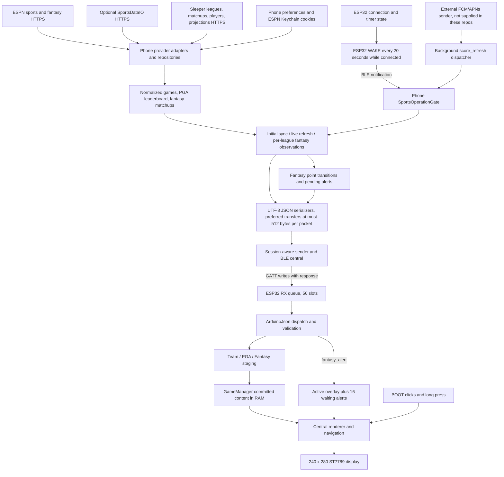

# SCRBRD production-readiness audit

Audit date: **October 13, 2026**. Scope: **audit and documentation only**.

| Repository | Audited commit | Audit checkout |
| --- | --- | --- |
| `scrbrd` firmware | `f5967a8993dcb03e1430002cbc3c3a357559cd39` | `scrbrd-codex`, branch `codex/production-audit` |
| `scrbrd-mobile` | `7785c601fb733369b8dd3057722460de6e96d733` | `scrbrd-mobile-codex`, branch `codex/production-audit` |

Both original `main` checkouts were clean and at these same commits when inspected. No application code, dependencies, external APIs, BLE protocol, production branch, signing configuration, or hardware provisioning was changed. Builds and diagnostic reproductions used temporary copies. This document is the only intended repository addition. Implementation must wait for review of this audit.

Source citations below use **F** for firmware and **M** for mobile and link to the audited commits. Line numbers refer to those commits, not a future implementation.

## 1. Readiness judgment

**SCRBRD is a valuable, functioning prototype with a credible path to production, but it is not ready for commercial manufacturing sign-off.** The main blockers are localized synchronization, recovery, data-validity, and device-ownership problems, plus an unproven field-maintenance and iOS background-service contract. A replacement architecture is not justified by the evidence.

There are meaningful protections already in place: bounded firmware storage, atomic team/PGA transfers, stable event selection, conservative serializer limits, provider-qualified fantasy identities, isolated league sessions, generation guards, coalesced refresh triggers, secure ESPN-cookie storage, and substantial tests. Preserve these while repairing the gaps.

**No P0 defect was established.** This does not establish electrical safety, regulatory compliance, or absence of every possible security defect; those cannot be determined from these two repositories. Several P1 defects were reproduced without hardware. The full original Flutter suite passes despite those gaps.

### Interpretation of severity and evidence

| Label | Meaning |
| --- | --- |
| **P0 — critical** | Catastrophic or irreversible harm, serious exposure, or a release emergency requiring immediate containment. None established here. |
| **P1 — high** | Core product correctness/recovery/security failure, or a prerequisite that should block commercial release until resolved or explicitly qualified. |
| **P2 — medium** | Material correctness, resilience, performance, UX, or maintenance problem with a bounded trigger or workable mitigation. |
| **P3 — low** | Polish, documentation detail, or a latent path without a current consumer trigger. |
| **Confirmed defect** | Demonstrated with current code or an unambiguous reachable implementation path. A mocked reproduction proves software behavior, not its physical occurrence rate. |
| **Confirmed gap/limitation** | A protection or capability is demonstrably absent; downstream incident frequency may remain unknown. |
| **Plausible risk** | Supporting code/build evidence exists, but the resulting failure has not been demonstrated. |
| **Unverified prerequisite/hypothesis** | Requires external records, representative provider data, hardware, or a product decision. It must not be presented as an established failure. |

Effort estimates are **engineering days for an experienced engineer**, including focused regression checks. Hardware qualification, commercial negotiations, store review, and manufacturing lead time are additional. Related estimates overlap and should not simply be added.

## 2. Architecture and interaction

### Mobile application

The phone is the internet-connected data producer and BLE central. `main()` initializes Firebase, push handling, and persisted sports preferences before building the app. `ConnectionScreen` creates and owns the connected runtime: BLE transport, tracked sports session, initial-sync and live-refresh coordinators, operation gate, Sleeper clients/projection service, and fantasy coordinator. It remains beneath pushed browsing/settings screens. Evidence: [M:lib/main.dart:35](https://github.com/againstthespread/scrbrd-mobile/blob/7785c601fb733369b8dd3057722460de6e96d733/lib/main.dart#L35), [M:lib/connection_screen.dart:91](https://github.com/againstthespread/scrbrd-mobile/blob/7785c601fb733369b8dd3057722460de6e96d733/lib/connection_screen.dart#L91).

| Layer | Current responsibilities and files |
| --- | --- |
| Sports providers | `EspnDataSource` is default; `SportsDataIODataSource` is selected by build-time definitions. Provider parsers produce `SportsGame`; `SportsRepository` maps to `GameData`. PGA uses a dedicated leaderboard interface. |
| User intent | Favorites, ordered/enabled content categories, college-football conference filters, provider-qualified fantasy league/team configuration, Primary league, per-league alert settings. Most preferences use SharedPreferences; ESPN cookies use secure storage. |
| Synchronization | `InitialDeviceSyncCoordinator` loads enabled categories. `TrackedDeviceSession` remembers successfully sent sports/PGA baselines. `LiveRefreshCoordinator` fetches tracked content concurrently, compares canonical content, and sends changes. `SportsOperationGate` coalesces WAKE/FCM work. |
| Fantasy | `FantasyLiveObservationCoordinator` owns per-league ESPN/Sleeper observation contexts, delta trackers, pending alerts, slate assembly, and projection-triggered display refreshes. Primary is ordering, not a separate top-level device category. |
| Wire delivery | Dedicated game/golf/fantasy serializers construct compact UTF-8 JSON. `SessionAwareDeviceSender` updates phone sports baselines after transport completion. `BluetoothDeviceTransport` scans, connects, subscribes to WAKE, and writes with response. |
| UI | Home, games, fantasy, discovery/setup, favorites, college football, content settings, and Developer Tools. `StatefulWidget`, `ChangeNotifier`, streams, and explicit coordinators provide state management without a large framework. |

This separation is generally useful. The main ownership problem is that desired content, successfully sent content, provider observation state, connection state, and actual device commitment are not consistently distinguished. The phone cannot currently inspect the device's committed state.

### Firmware

The ESP32-S3 is a BLE peripheral and presentation appliance. It has no implemented direct sports-API, Wi-Fi, or cloud-fetch path. Arduino/C++ receives normalized data, validates it, caches presentation records in RAM, and draws the 240×280 ST7789 over SPI.

| Component | Responsibility |
| --- | --- |
| `BluetoothManager.cpp` | Advertising, connection flags, writable RX characteristic, 56-message incoming queue, notify-only `WAKE` every 20 seconds. |
| `scrbrd.ino` | Packet dispatch/validation, sports/PGA transfer staging, synchronization state, rendering, fantasy-alert overlay/FIFO, standby, and BOOT-button timing. Approximately 2,325 lines. |
| `GameManager.cpp/.h` | Up to eight received categories, navigation, stable event selection, one shared large sports buffer, PGA pages, and active/staged fantasy matchups. |
| `game_data.h`, `fantasy_projection.h` | Fixed-size display records, mock fixtures, optional-projection validation/formatting. |
| `pin_config.h` | Display geometry, colors, and verified GPIO wiring. |

The loop updates BLE/timers, processes **one incoming message**, services the BOOT button, and yields 10 ms. Display rendering runs in that loop, outside the BLE callback. Standby switches the backlight; it does not suspend BLE or enter deep sleep. An alert temporarily wakes standby and the final queued alert restores it. Evidence: [F:scrbrd.ino:2145](https://github.com/againstthespread/scrbrd/blob/f5967a8993dcb03e1430002cbc3c3a357559cd39/scrbrd.ino#L2145), [F:scrbrd.ino:2320](https://github.com/againstthespread/scrbrd/blob/f5967a8993dcb03e1430002cbc3c3a357559cd39/scrbrd.ino#L2320), [F:scrbrd.ino:168](https://github.com/againstthespread/scrbrd/blob/f5967a8993dcb03e1430002cbc3c3a357559cd39/scrbrd.ino#L168).

Received data survives ordinary BLE disconnect in RAM and is marked `UPDATES PAUSED`. It does not survive device reboot. Although mock data exists, the production renderer checks received-content/display state and does not automatically present fake scores to a disconnected consumer. Evidence: [F:scrbrd.ino:863](https://github.com/againstthespread/scrbrd/blob/f5967a8993dcb03e1430002cbc3c3a357559cd39/scrbrd.ino#L863).

### Data flow

The write response confirms GATT handling, **not firmware validation, commit, or rendering**. There is no application receipt, content checksum, device catalog readback, or firmware-capability negotiation. The dashed push path has receiver code, but the external sending service and its operating configuration were not audited.

### Scheduling, state, and fantasy semantics

On a new connection, mobile sends `SYNC_START`, clears tracked phone content, loads enabled categories in user order, and sends `SYNC_COMPLETE` if any category reports success or `SYNC_EMPTY` if none reports success and there were no failures. An empty fantasy slate currently counts as success despite loading no category (F37). Ordinary refresh is driven chiefly by device `WAKE`; there is no periodic foreground refresh timer in the connected runtime. Resume currently logs lifecycle state. Sports refresh fetches tracked leagues in parallel, waits for all, then writes sequentially. Fantasy follows sports and observes configured leagues sequentially. Evidence: [M:lib/initial_device_sync_coordinator.dart:100](https://github.com/againstthespread/scrbrd-mobile/blob/7785c601fb733369b8dd3057722460de6e96d733/lib/initial_device_sync_coordinator.dart#L100), [M:lib/live_refresh_coordinator.dart:42](https://github.com/againstthespread/scrbrd-mobile/blob/7785c601fb733369b8dd3057722460de6e96d733/lib/live_refresh_coordinator.dart#L42), [M:lib/fantasy_live_observation_coordinator.dart:45](https://github.com/againstthespread/scrbrd-mobile/blob/7785c601fb733369b8dd3057722460de6e96d733/lib/fantasy_live_observation_coordinator.dart#L45).

Actual fantasy points come from providers; the device does not calculate league scoring. ESPN projections pass through `totalProjectedPointsLive`. Sleeper projections use league scoring settings and frozen pregame starter baselines, replacing each starter with actual points when the corresponding NFL game is final. Optional missing projections do not invalidate actual matchup data. Some kicker projection fields use explicit approximation ratios; see F28 below. Point alerts describe observed cumulative point changes, not verified individual play-by-play events.

## 3. BLE contract review

| Aspect | Implemented contract and practical limit |
| --- | --- |
| Identity | Advertising name `Peter Sports Hub`; service `d8f6a9b0-7a5e-4e8c-9f2a-2b2f5b6c1001`; RX UUID changes the first segment to `d8f6a9b1`; WAKE to `d8f6a9b2`. |
| Encoding | Version 1 compact UTF-8 JSON, plus short text lifecycle/navigation commands. Preferred team/PGA transfers and fantasy packets enforce 512 encoded bytes. Legacy single-game serialization/receipt lack an explicit total-byte check (F34). Limits are bytes where validated, despite some documentation saying characters. |
| Team sports | Legacy single-game/1–4-game slate support; preferred `slate_start` → ascending `slate_chunk` → `slate_end`. Transfer ID, totals, validation, and 30-second inactivity expiry guard atomic commitment. Logical maximum 72 games. |
| PGA | `golf_start/chunk/end`, transfer ID/counts/order/expiry, up to 50 golfers, five rows per display page. |
| Storage | Eight categories; inline team storage to 20 games each; only one category can own the shared 21–72-game buffer. PGA and Fantasy count as categories. |
| Fantasy | `fantasy_slate_start` → provider-qualified `fantasy_matchup` entries → `fantasy_slate_end`; up to eight matchups, duplicate staged identities replace in place. Start/end lack transfer identity, declared totals, normal header validation, and expiry. |
| Compatibility | Legacy standalone fantasy matchup is accepted outside staging but cannot replace a committed multi-matchup slate. `fantasy_clear` removes Fantasy; alerts are independent of its persistent storage. |
| Alerts | One active seven-second overlay plus 16 waiting entries; newest rejected on overflow. Phone pending/dedup state and device queues are in memory. |
| Reverse path | Notify-only text `WAKE`; no acceptance/commit/overflow response, firmware version, ownership state, or manifest. |

Sources: [M:lib/sports_hub_ble_protocol.dart:1](https://github.com/againstthespread/scrbrd-mobile/blob/7785c601fb733369b8dd3057722460de6e96d733/lib/sports_hub_ble_protocol.dart#L1), [M:lib/game_packet_serializer.dart:1](https://github.com/againstthespread/scrbrd-mobile/blob/7785c601fb733369b8dd3057722460de6e96d733/lib/game_packet_serializer.dart#L1), [M:lib/golf_packet_serializer.dart:1](https://github.com/againstthespread/scrbrd-mobile/blob/7785c601fb733369b8dd3057722460de6e96d733/lib/golf_packet_serializer.dart#L1), [M:lib/fantasy_matchup_packet_serializer.dart:1](https://github.com/againstthespread/scrbrd-mobile/blob/7785c601fb733369b8dd3057722460de6e96d733/lib/fantasy_matchup_packet_serializer.dart#L1), [F:BluetoothManager.cpp:70](https://github.com/againstthespread/scrbrd/blob/f5967a8993dcb03e1430002cbc3c3a357559cd39/BluetoothManager.cpp#L70), [F:GameManager.h:15](https://github.com/againstthespread/scrbrd/blob/f5967a8993dcb03e1430002cbc3c3a357559cd39/GameManager.h#L15).

**Do not classify 512-byte writes as proven MTU breakage.** The inspected ESP32 core supports prepared long writes, and native iOS Bluetooth handles write mechanics. Maximum-size interoperability, prepared-write receipt, timing, and saturation still require physical qualification. There is no evidence here warranting an unreviewed packet-size or protocol change.

## 4. Prioritized findings

| ID | Priority | Finding | Evidence classification |
| --- | --- | --- | --- |
| F01 | P1 | Rapid reconnect can lose the new initial sync indefinitely | Confirmed, reproduced |
| F02 | P1 | Stale writes report success and logical transfers can cross connections | Confirmed, reproduced |
| F03 | P1 | Fantasy refresh resets selection and commits without redrawing | Confirmed, reproduced |
| F04 | P1 | Fantasy transfer integrity and cancellation are incomplete | Confirmed, reproduced |
| F05 | P1 | ATT success can hide firmware rejection and suppress retry | Confirmed design gap |
| F06 | P1 | Firmware RX queue has cross-task data races | Confirmed implementation defect; incidence unmeasured |
| F07 | P1 | Offline reconnect erases useful cached content | Confirmed failure path |
| F08 | P1 | Refresh cannot recover absent categories or roll to a new day | Confirmed behavior |
| F10 | P1 | Missing ESPN player stats produce false loss/gain alerts | Confirmed, reproduced |
| F12 | P1 | ESPN Keychain policy conflicts with locked-phone refresh | Confirmed configuration; physical manifestation untested |
| F13 | P1 | Automatic reconnect and iOS state restoration are absent | Confirmed gap |
| F14 | P1 | BLE device ownership/authentication is absent | Confirmed security gap |
| F15 | P1 | Consumer field-update/recovery strategy is absent | Confirmed release gap |
| F16 | P1 | Commercial provider permission/support must be verified | Unverified launch prerequisite |
| F17 | P1 | Background workload can exceed the available execution window | Plausible service-reliability risk |
| F09 | P2 | Failed Sleeper week rollover keeps the old week for six hours | Confirmed, reproduced |
| F11 | P2 | Alert aggregation consumes distinct transitions and miscounts leagues | Confirmed, reproduced |
| F18 | P2 | WAKE subscription failure has no recovery | Confirmed gap |
| F19 | P2 | FCM foreground handling and completion semantics are incomplete | Confirmed gaps |
| F20 | P2 | Delivery success and data freshness are represented inaccurately | Confirmed semantics/limitation |
| F37 | P2 | Empty fantasy startup counts as loaded content and suppresses empty state | Confirmed failure path |
| F21 | P2 | Fantasy LIVE/FINAL status is based on score presence | Confirmed mapping defect |
| F22 | P2 | Sleeper league/scoring metadata remains cached indefinitely | Confirmed cache behavior |
| F23 | P2 | Missing sports scores silently become zero | Confirmed mapping; provider occurrence unverified |
| F24 | P2 | MLB display shows invented zero-out/empty-base state | Confirmed rendering defect |
| F25 | P2 | Player metadata can delay alerts and remain stale | Confirmed paths; performance impact unmeasured |
| F26 | P2 | Alert burst, recurrence, and reconnect policy is incomplete | Confirmed limitations; policy review needed |
| F27 | P2 | Firmware stack/heap margins need qualification | Measured costs; runtime exhaustion unverified |
| F28 | P2 | Some Sleeper projection fields are approximations | Confirmed calculation; expected accuracy unverified |
| F29 | P2 | Runtime lifetime and competing send ownership are fragmented | Confirmed structure/contention; some effects plausible |
| F30 | P2 | Preference-save failures can leave false persisted state | Confirmed error-handling gap |
| F31 | P2 | Optional startup services can prevent the app from opening | Confirmed unhandled path; incidence unverified |
| F32 | P2 | Firmware test runner broke; CI/cross-language tests are missing | Confirmed regression-prevention gap |
| F33 | P2 | Release, privacy, and manufacturing evidence is incomplete | Confirmed repository gaps; external state unverified |
| F34 | P2 | Protocol documents describe different contracts | Confirmed documentation drift |
| F35 | P2 | Consumer permission/setup/recovery UX needs completion | Confirmed UX limitations |
| F36 | P3 | Latent previous-navigation and international text limitations | Confirmed latent/capability issues |

### F01 — Rapid reconnect loses new startup ownership

`InitialDeviceSyncCoordinator.handleConnectionState()` marks a newly connected session active before acquiring startup ownership. `SportsOperationGate.runInitialSync()` simply returns when an older sync owns the gate. If reconnect occurs while the older generation awaits an API, the new sync is discarded; the old generation later exits, and subsequent connected events are ignored.

**Reproduction:** hold first fetch → disconnect → reconnect → finish old fetch → emit connected again. Only the original `SYNC_START`/fetch occurred; no new sync started and status remained `syncing`. Evidence: [M:lib/initial_device_sync_coordinator.dart:72](https://github.com/againstthespread/scrbrd-mobile/blob/7785c601fb733369b8dd3057722460de6e96d733/lib/initial_device_sync_coordinator.dart#L72), [M:lib/sports_operation_gate.dart:19](https://github.com/againstthespread/scrbrd-mobile/blob/7785c601fb733369b8dd3057722460de6e96d733/lib/sports_operation_gate.dart#L19), [M:lib/initial_device_sync_coordinator.dart:239](https://github.com/againstthespread/scrbrd-mobile/blob/7785c601fb733369b8dd3057722460de6e96d733/lib/initial_device_sync_coordinator.dart#L239).

**Recommended fix:** queue/replace startup ownership by generation; mark startup acquired only after acquisition; give cancelled work an explicit terminal outcome. **Effort: 1–2 days.** Autonomous Dart implementation after review; physical rapid-reconnect qualification required.

### F02 — A cancelled BLE delivery can succeed or continue on another session

`_sendPacket()` prevents stale completion from visually restoring `connected`, but returns normally after a successful native write from an obsolete connection. `sendGameSlate()`, golf, and fantasy capture generation separately for each packet rather than for the whole transaction. `SessionAwareDeviceSender` therefore can record an undelivered baseline, and alert draining can remove pending work.

**Reproductions:** disconnect during final `slate_end`, then complete the old write: sender succeeds and records content while disconnected. Disconnect/reconnect during start, then complete it: remaining chunks/end are sent on the new generation without a new start. Evidence: [M:lib/bluetooth_device_transport.dart:253](https://github.com/againstthespread/scrbrd-mobile/blob/7785c601fb733369b8dd3057722460de6e96d733/lib/bluetooth_device_transport.dart#L253), [M:lib/bluetooth_device_transport.dart:334](https://github.com/againstthespread/scrbrd-mobile/blob/7785c601fb733369b8dd3057722460de6e96d733/lib/bluetooth_device_transport.dart#L334), [M:lib/session_aware_device_sender.dart:60](https://github.com/againstthespread/scrbrd-mobile/blob/7785c601fb733369b8dd3057722460de6e96d733/lib/session_aware_device_sender.dart#L60), [M:lib/fantasy_live_observation_coordinator.dart:943](https://github.com/againstthespread/scrbrd-mobile/blob/7785c601fb733369b8dd3057722460de6e96d733/lib/fantasy_live_observation_coordinator.dart#L943).

**Recommended fix:** pin complete logical delivery to one generation; throw/return cancellation on mismatches, including final completion; advance baseline only for the still-current session. **Effort: 1–2 days.** No wire change required.

### F03 — Fantasy refresh changes RAM selection without updating pixels

Every ordinary fantasy observation sends a full replacement, including unchanged content. `commitFantasySlate()` resets selection to index 0. Matchup packets redraw while they are merely staged, showing the previous snapshot; `fantasy_slate_end` commits and returns without drawing. Routine refresh has no startup `SYNC_COMPLETE` to repair that omission.

**Native reproductions:** selecting B then recommitting A/B selects A; updating actual score 10→20 leaves RAM at 20 and the render stub at 10, with no redraw at end. These findings explain apparent repeated cycling and stale fantasy pixels without proving duplicate categories exist. Evidence: [M:lib/fantasy_live_observation_coordinator.dart:578](https://github.com/againstthespread/scrbrd-mobile/blob/7785c601fb733369b8dd3057722460de6e96d733/lib/fantasy_live_observation_coordinator.dart#L578), [F:GameManager.cpp:336](https://github.com/againstthespread/scrbrd/blob/f5967a8993dcb03e1430002cbc3c3a357559cd39/GameManager.cpp#L336), [F:scrbrd.ino:1437](https://github.com/againstthespread/scrbrd/blob/f5967a8993dcb03e1430002cbc3c3a357559cd39/scrbrd.ino#L1437), [F:scrbrd.ino:2091](https://github.com/againstthespread/scrbrd/blob/f5967a8993dcb03e1430002cbc3c3a357559cd39/scrbrd.ino#L2091).

**Recommended fix:** preserve selected matchup by stable identity; redraw/activate once on commit; retain explicit league-entry reset to Primary; suppress unchanged fantasy transfers. **Effort: 1–2 days.** Actual button/display behavior requires hardware verification.

### F04 — Fantasy transfer integrity is weaker than the documented guarantee

Fantasy start/end are routed solely by `type`, bypassing normal version/UTF-8/header checks. A rejected matchup does not invalidate its transfer. Commit accepts whatever valid entries remain, including zero. There is no inactivity timeout or complete-transfer identity/count. `clearReceivedContent()`, `clearReceivedFantasyMatchup()`, and disconnect do not consistently clear fantasy staging/count/flags. Outbound fantasy serialization occurs after start, so a later invalid entry also leaves an abandoned transfer.

**Reproductions:** valid A plus rejected entry followed by end commits only A; staging B followed by clear/catalog reset and late end resurrects B; unsupported-version start/end are accepted and an empty end clears Fantasy. Missing-entry loss detection is structurally impossible with the current envelope. Evidence: [F:GameManager.cpp:8](https://github.com/againstthespread/scrbrd/blob/f5967a8993dcb03e1430002cbc3c3a357559cd39/GameManager.cpp#L8), [F:GameManager.cpp:313](https://github.com/againstthespread/scrbrd/blob/f5967a8993dcb03e1430002cbc3c3a357559cd39/GameManager.cpp#L313), [F:GameManager.cpp:363](https://github.com/againstthespread/scrbrd/blob/f5967a8993dcb03e1430002cbc3c3a357559cd39/GameManager.cpp#L363), [F:scrbrd.ino:2086](https://github.com/againstthespread/scrbrd/blob/f5967a8993dcb03e1430002cbc3c3a357559cd39/scrbrd.ino#L2086), [F:scrbrd.ino:2154](https://github.com/againstthespread/scrbrd/blob/f5967a8993dcb03e1430002cbc3c3a357559cd39/scrbrd.ino#L2154), [M:lib/bluetooth_device_transport.dart:317](https://github.com/againstthespread/scrbrd-mobile/blob/7785c601fb733369b8dd3057722460de6e96d733/lib/bluetooth_device_transport.dart#L317).

**Recommended fix:** prevalidate outbound entries; validate existing envelopes; track failed staging; cancel on disconnect/clear/new session/timeout; keep committed cache intact after failed transfers. **Effort: 2–4 days** for current-contract protection. Transfer IDs/counts/receipts require a separately reviewed future compatibility design, **3–5+ days**, and cannot be introduced during this audit.

### F05 — Write response does not establish device acceptance

Firmware RX callback returns after enqueueing, or logs and rejects on queue overflow. Parsing, capacity checks, commitment, and rendering happen later. The installed ESP32 core sends GATT success after `onWrite()`; there is no application error/receipt path. Phone baseline comparison can suppress identical data forever after the device rejected it, and an alert can be removed without ever displaying. Evidence: [F:BluetoothManager.cpp:44](https://github.com/againstthespread/scrbrd/blob/f5967a8993dcb03e1430002cbc3c3a357559cd39/BluetoothManager.cpp#L44), [F:scrbrd.ino:2145](https://github.com/againstthespread/scrbrd/blob/f5967a8993dcb03e1430002cbc3c3a357559cd39/scrbrd.ino#L2145), [M:lib/session_aware_device_sender.dart:60](https://github.com/againstthespread/scrbrd-mobile/blob/7785c601fb733369b8dd3057722460de6e96d733/lib/session_aware_device_sender.dart#L60), [M:lib/live_refresh_coordinator.dart:151](https://github.com/againstthespread/scrbrd-mobile/blob/7785c601fb733369b8dd3057722460de6e96d733/lib/live_refresh_coordinator.dart#L151). The active NimBLE core source is `libraries/BLE/src/BLECharacteristic.cpp:956–999`, `BLE_GATT_ACCESS_OP_WRITE_CHR`: it calls `onWrite()` and returns zero, with NimBLE sending the response after return (core 3.3.11).

**Classification:** acceptance gap confirmed; actual overflow/loss rate on the hardware is unmeasured. Do not describe passing ATT futures as end-to-end synchronization.

**Recommended fix:** first harden queues, cancellation, local diagnostics, and logical ownership. Then approve a receipt/status and idempotent-retry design with compatibility and backpressure. **Effort: 2–3 days** immediate hardening; **3–7 days** receipt/retry work plus hardware qualification. Protocol work is a review decision.

### F06 — RX queue crosses tasks without synchronization

The BLE callback increments `receivedMessageCount`; loop consumption decrements it. Both read/modify/write operations and shared `String` slots are unsynchronized; `volatile` does not make the queue atomic. The audited build places the BLE host task on core 0 and Arduino loop on core 1. Connection/advertising flags are also shared. Evidence: [F:BluetoothManager.cpp:17](https://github.com/againstthespread/scrbrd/blob/f5967a8993dcb03e1430002cbc3c3a357559cd39/BluetoothManager.cpp#L17), [F:BluetoothManager.cpp:48](https://github.com/againstthespread/scrbrd/blob/f5967a8993dcb03e1430002cbc3c3a357559cd39/BluetoothManager.cpp#L48), [F:BluetoothManager.cpp:185](https://github.com/againstthespread/scrbrd/blob/f5967a8993dcb03e1430002cbc3c3a357559cd39/BluetoothManager.cpp#L185).

**Recommended fix:** use a task-safe bounded FreeRTOS queue or carefully synchronized fixed buffer, with a defined memory budget. Keep parsing/drawing out of callbacks and keep logging out of critical sections. **Effort: 1–2 days**, then concurrent saturation/soak testing on hardware. A specific observed consumer packet loss was not attributed to this race.

### F07 — Reconnecting without internet destroys cached working content

Phone sends `SYNC_START` and clears its tracked session before fetching replacement data. Device immediately clears its catalog. With zero successful categories and provider failures, mobile sends neither complete nor empty. The display can remain connected/loading; subsequent sports wakes have no tracked content to retry. Ordinary disconnect cache preservation is therefore negated by offline reconnect. Evidence: [M:lib/initial_device_sync_coordinator.dart:112](https://github.com/againstthespread/scrbrd-mobile/blob/7785c601fb733369b8dd3057722460de6e96d733/lib/initial_device_sync_coordinator.dart#L112), [M:lib/initial_device_sync_coordinator.dart:197](https://github.com/againstthespread/scrbrd-mobile/blob/7785c601fb733369b8dd3057722460de6e96d733/lib/initial_device_sync_coordinator.dart#L197), [F:scrbrd.ino:1998](https://github.com/againstthespread/scrbrd/blob/f5967a8993dcb03e1430002cbc3c3a357559cd39/scrbrd.ino#L1998).

**Recommended fix:** fetch/validate before destructive reconciliation; represent failed/unknown separately from genuinely empty; preserve stale cache and offer retry. Whole-catalog reconciliation is not atomic under today's contract, so changing `SYNC_START` semantics needs coordinated review. **Effort: 2–4 days** plus offline/reconnect tests.

### F08 — Refresh follows delivered baselines rather than current user intent

Initial sync calculates today once and skips failed/empty categories. Wake refresh enumerates only successfully delivered `TrackedDeviceSession` entries and fetches their original date/tournament. There is no midnight, new-tournament, or resumed-app rollover. An enabled category initially absent never becomes eligible for WAKE rediscovery; a continuously connected unit can remain on yesterday's scores indefinitely. Evidence: [M:lib/initial_device_sync_coordinator.dart:100](https://github.com/againstthespread/scrbrd-mobile/blob/7785c601fb733369b8dd3057722460de6e96d733/lib/initial_device_sync_coordinator.dart#L100), [M:lib/initial_device_sync_coordinator.dart:168](https://github.com/againstthespread/scrbrd-mobile/blob/7785c601fb733369b8dd3057722460de6e96d733/lib/initial_device_sync_coordinator.dart#L168), [M:lib/live_refresh_coordinator.dart:52](https://github.com/againstthespread/scrbrd-mobile/blob/7785c601fb733369b8dd3057722460de6e96d733/lib/live_refresh_coordinator.dart#L52), [M:lib/live_refresh_coordinator.dart:94](https://github.com/againstthespread/scrbrd-mobile/blob/7785c601fb733369b8dd3057722460de6e96d733/lib/live_refresh_coordinator.dart#L94), [M:lib/connection_screen.dart:260](https://github.com/againstthespread/scrbrd-mobile/blob/7785c601fb733369b8dd3057722460de6e96d733/lib/connection_screen.dart#L260).

**Recommended fix:** retain desired enabled categories independently of delivery baselines; distinguish consumer today mode from explicit historical Developer Tools selections; add bounded retry/discovery and day/tournament rollover. Preserve conservative transient-empty handling. **Effort: 3–5 days** plus overnight/date-boundary qualification.

### F09 — Sleeper week rollover fails non-atomically

`refreshMatchups()` records a new `_weekCheckedAt` after NFL-state fetch, but commits the new-week snapshot only after matchup fetch succeeds. If that fetch fails, the old snapshot remains paired with a fresh six-hour check timestamp.

**Reproduction:** cached week 6 → NFL state week 7 → one failed `/matchups/7` → recovered retry requests `/matchups/6` and returns week 6. Evidence: [M:lib/sleeper_fantasy_repository.dart:129](https://github.com/againstthespread/scrbrd-mobile/blob/7785c601fb733369b8dd3057722460de6e96d733/lib/sleeper_fantasy_repository.dart#L129).

**Recommended fix:** commit state/check time consistently with a successful snapshot, or retain a pending desired-week target for immediate retry. **Effort: 0.5–1 day.**

### F10 — ESPN absent stats are incorrectly treated as authoritative zero

`_parseSide()` initializes player actual points to zero when stats are missing or contain no current-period actual row. The normalized delta tracker accepts that zero and changes its baseline. Sleeper already has missing-value retention behavior that should be preserved.

**Reproduction:** reliable 10 points → temporary empty stats → reliable 10 points produces false **−10 and +10** alerts. Evidence: [M:lib/espn_fantasy_repository.dart:250](https://github.com/againstthespread/scrbrd-mobile/blob/7785c601fb733369b8dd3057722460de6e96d733/lib/espn_fantasy_repository.dart#L250), [M:lib/fantasy_point_delta_tracker.dart:238](https://github.com/againstthespread/scrbrd-mobile/blob/7785c601fb733369b8dd3057722460de6e96d733/lib/fantasy_point_delta_tracker.dart#L238).

**Recommended fix:** distinguish missing points from real zero; retain reliable player baseline across unavailable rows; preserve legitimate negative corrections. **Effort: 1–2 days.**

### F11 — Alert aggregation confuses events and leagues

Draining groups only by canonical player, uses number of queued transitions as league count, presents the first delta/matchup totals, and marks every member delivered. `sameDelta` affects logs only.

**Reproduction:** one league, points 10→11→12 across failed writes; recovery sends one **“Scored in 2 leagues”**, +1, with stale team score 11, and consumes both events. Different league scoring/corrections can likewise disappear behind the first value. Some existing tests explicitly accept first-value cross-league presentation; that portion needs a product contract, not silent replacement. Evidence: [M:lib/fantasy_live_observation_coordinator.dart:906](https://github.com/againstthespread/scrbrd-mobile/blob/7785c601fb733369b8dd3057722460de6e96d733/lib/fantasy_live_observation_coordinator.dart#L906).

**Recommended fix:** retain league/event identity and ordering; count unique leagues; aggregate only compatible observations under an approved rule for different scoring and corrections. **Effort: 1–3 days.**

### F12 — Locked-phone ESPN access conflicts with the Keychain configuration

`DeviceSecureStringStorage` uses default `FlutterSecureStorage`. Installed version 11.2.0 defaults Apple accessibility to `KeychainAccessibility.unlocked`. ESPN client reads those credentials for every request and converts read failure to missing credentials. Background work on a locked phone therefore lacks a credential-access policy compatible with its intended operation. Evidence: [M:lib/espn_fantasy_credentials.dart:34](https://github.com/againstthespread/scrbrd-mobile/blob/7785c601fb733369b8dd3057722460de6e96d733/lib/espn_fantasy_credentials.dart#L34), [M:lib/espn_fantasy_client.dart:99](https://github.com/againstthespread/scrbrd-mobile/blob/7785c601fb733369b8dd3057722460de6e96d733/lib/espn_fantasy_client.dart#L99); installed `flutter_secure_storage` `AppleOptions` default, line 72. Apple's [WhenUnlocked documentation](https://developer.apple.com/documentation/security/ksecattraccessiblewhenunlocked) restricts access to an unlocked device.

**Recommended fix:** qualified security/iOS review should choose the narrowest accessibility that supports the required background use, potentially a device-only after-first-unlock policy, with explicit migration and unavailable-before-first-unlock handling. Do not weaken storage automatically or move cookies into preferences/logs. **Effort: 1–2 days** implementation plus locked/rebooted iPhone verification. Exact current runtime symptoms have not been physically reproduced.

### F13 — Recovery depends on manual connection

Unexpected disconnect reports disconnected; no saved device identity, automatic retry/backoff, or resume reconnect policy exists. Installed `reactive_ble_mobile` 5.5.0 creates `CBCentralManager` without a restoration identifier and provides no `willRestoreState` handling. In-memory sessions cannot restore a terminated process by themselves. Evidence: [M:lib/bluetooth_device_transport.dart:200](https://github.com/againstthespread/scrbrd-mobile/blob/7785c601fb733369b8dd3057722460de6e96d733/lib/bluetooth_device_transport.dart#L200), [M:lib/connection_screen.dart:260](https://github.com/againstthespread/scrbrd-mobile/blob/7785c601fb733369b8dd3057722460de6e96d733/lib/connection_screen.dart#L260); package `ReactiveBle/Central.swift:124–127`.

Apple documents optional preservation/restoration rather than guaranteeing that background modes keep an app resident. See [Core Bluetooth background processing](https://developer.apple.com/library/archive/documentation/NetworkingInternetWeb/Conceptual/CoreBluetooth_concepts/CoreBluetoothBackgroundProcessingForIOSApps/PerformingTasksWhileYourAppIsInTheBackground.html) and [TN3115 restoration relaunch rules](https://developer.apple.com/documentation/technotes/tn3115-bluetooth-state-restoration-app-relaunch-rules).

**Recommended fix:** define supported locked/background/terminated behavior; remember the chosen device; implement bounded reconnect respecting explicit user disconnect; investigate minimal native restoration support while preserving the current dependency. **Effort: 3–5 days** app recovery, **5–10 additional days** if native restoration is required, plus multi-day qualification.

### F14 — Any nearby central can write without an ownership policy

Firmware creates public WRITE/WRITE_NR characteristics without pairing, bonding, encrypted/authenticated permissions, or owner validation. Device discovery accepts matching name or service; neither authenticates a unit. Another nearby central can connect while available and send sync/navigation/content/alerts. No ESPN cookies are sent to the scoreboard, but personal fantasy names/scores lack an established protected BLE channel. Evidence: [F:BluetoothManager.cpp:77](https://github.com/againstthespread/scrbrd/blob/f5967a8993dcb03e1430002cbc3c3a357559cd39/BluetoothManager.cpp#L77), [M:lib/bluetooth_device_transport.dart:470](https://github.com/againstthespread/scrbrd-mobile/blob/7785c601fb733369b8dd3057722460de6e96d733/lib/bluetooth_device_transport.dart#L470).

**Recommended fix:** define consumer ownership, pairing/bonding, multi-phone support, factory reset, and recovery; evaluate a physical pairing window and authenticated link using existing capabilities. Security and onboarding require joint review before implementation. **Effort: 3–7 days** plus security/hardware tests. No attack or unauthorized access was performed.

### F15 — No established consumer field-maintenance path

Firmware has manual Arduino compile/upload instructions, but no implemented updater, signed-update acceptance, rollback flow, exposed firmware version/capability, release manifest, or consumer recovery workflow. Default build OTA partitions alone do not implement updates. Secure boot/flash encryption are not enabled in the audited default build. Evidence: [F:README.md:62](https://github.com/againstthespread/scrbrd/blob/f5967a8993dcb03e1430002cbc3c3a357559cd39/README.md#L62), [F:scrbrd.ino:2296](https://github.com/againstthespread/scrbrd/blob/f5967a8993dcb03e1430002cbc3c3a357559cd39/scrbrd.ino#L2296), [F:BluetoothManager.cpp:70](https://github.com/againstthespread/scrbrd/blob/f5967a8993dcb03e1430002cbc3c3a357559cd39/BluetoothManager.cpp#L70); audited generated partition/sdk configuration.

**Recommended fix:** choose a supportable USB/service recovery process or a reviewed authenticated updater with interruption recovery. Define SKU/board options, signing/provenance, compatibility matrix, version reporting, factory flash verification, and RMA process. OTA is not intrinsically mandatory; a credible maintenance path is. **Effort: 3–5 days** release/recovery design; **2–4 weeks** if robust OTA is selected. Qualified embedded review and power-interruption testing are required. Espressif's [Secure Boot v2 guidance](https://docs.espressif.com/projects/esp-idf/en/stable/esp32s3/security/secure-boot-v2.html) also makes clear that security provisioning affects future update/recovery choices. No eFuses should be burned autonomously.

### F16 — Commercial data access is a launch prerequisite

The product directly calls ESPN sports/fantasy endpoints, Sleeper public API plus a projection endpoint absent from its published endpoint documentation, and optional SportsDataIO. There are no provider contracts/support guarantees in the supplied repositories. This does not prove agreements do not exist.

Sleeper's current [official API documentation](https://docs.sleeper.com/) limits free use to non-commercial purposes and asks commercial users to discuss licensing. Confirm commercial permission, distribution/display rights, polling allowances, rate limits, data retention, and support/change notification with each provider. **Classification: unverified prerequisite, not a confirmed licensing violation.** Evidence: [M:lib/sleeper_api_client.dart:18](https://github.com/againstthespread/scrbrd-mobile/blob/7785c601fb733369b8dd3057722460de6e96d733/lib/sleeper_api_client.dart#L18), [M:lib/espn_fantasy_client.dart:108](https://github.com/againstthespread/scrbrd-mobile/blob/7785c601fb733369b8dd3057722460de6e96d733/lib/espn_fantasy_client.dart#L108), [M:lib/sports_data_provider.dart:28](https://github.com/againstthespread/scrbrd-mobile/blob/7785c601fb733369b8dd3057722460de6e96d733/lib/sports_data_provider.dart#L28).

**Effort:** 1–3 engineering days to inventory endpoints and traffic/fixtures; commercial/legal lead time is unknown. Qualified business/legal review is necessary; this audit did not contact providers.

### F17 — Background refresh has no overall execution budget

Sports completes before fantasy; fantasy leagues observe sequentially. ESPN loads league then matchup with per-request timeouts of 12 seconds. Eight timeout-bound ESPN leagues could consume approximately 192 seconds before delivery, in addition to sports and BLE work. Dispatcher waiting expires at 25 seconds without cancelling the actual job. No deadline prioritizes urgent alerts/actual scores over optional metadata/projections. Evidence: [M:lib/fantasy_live_observation_coordinator.dart:45](https://github.com/againstthespread/scrbrd-mobile/blob/7785c601fb733369b8dd3057722460de6e96d733/lib/fantasy_live_observation_coordinator.dart#L45), [M:lib/fantasy_live_observation_coordinator.dart:542](https://github.com/againstthespread/scrbrd-mobile/blob/7785c601fb733369b8dd3057722460de6e96d733/lib/fantasy_live_observation_coordinator.dart#L542), [M:lib/espn_fantasy_repository.dart:23](https://github.com/againstthespread/scrbrd-mobile/blob/7785c601fb733369b8dd3057722460de6e96d733/lib/espn_fantasy_repository.dart#L23), [M:lib/background_score_refresh_dispatcher.dart:37](https://github.com/againstthespread/scrbrd-mobile/blob/7785c601fb733369b8dd3057722460de6e96d733/lib/background_score_refresh_dispatcher.dart#L37).

Apple describes roughly ten seconds following a Bluetooth wake in its [background guide](https://developer.apple.com/library/archive/documentation/NetworkingInternetWeb/Conceptual/CoreBluetooth_concepts/CoreBluetoothBackgroundProcessingForIOSApps/PerformingTasksWhileYourAppIsInTheBackground.html). Firebase warns lengthy background processing can be terminated in its [Flutter message guidance](https://firebase.google.com/docs/cloud-messaging/flutter/receive-messages). Silent pushes are also best-effort and throttled, per Apple's [background-update guidance](https://developer.apple.com/documentation/usernotifications/pushing-background-updates-to-your-app).

**Recommended fix:** agree on supported freshness/latency promises; use bounded concurrent fetches, deadline/cancellation, priority, and explicit incomplete outcomes with one sequential BLE send phase. **Effort: 2–4 days** plus iPhone measurements. A fixed 20-second all-day freshness guarantee is not established by the timer or successful builds.

### F18 — WAKE subscription failure silently removes the ordinary refresh trigger

WAKE subscription error/done only logs. The connection can still look healthy while periodic refresh stops; there is no resubscribe, subscription-health state, or elapsed-freshness/resume fallback. Evidence: [M:lib/bluetooth_device_transport.dart:528](https://github.com/againstthespread/scrbrd-mobile/blob/7785c601fb733369b8dd3057722460de6e96d733/lib/bluetooth_device_transport.dart#L528), [M:lib/connection_screen.dart:266](https://github.com/againstthespread/scrbrd-mobile/blob/7785c601fb733369b8dd3057722460de6e96d733/lib/connection_screen.dart#L266).

**Recommended fix:** track subscription health; bounded resubscribe/reconnect; trigger freshness checks on resume; keep trigger coalescing. **Effort: 1–2 days** plus CCCD/stream-failure hardware tests.

### F19 — FCM receiver paths and completion semantics are incomplete

Only `onBackgroundMessage` is registered; there is no `FirebaseMessaging.onMessage` listener for foreground refreshes. Push setup obtains a token once, but no token-refresh registration/production sender integration is present. The external server configuration is unknown. `requestLiveRefresh()` returns when work is deferred; dispatcher completion can therefore mean queued rather than finished. `runBackgroundScoreRefresh()` acknowledges in `finally`, including failed work. Evidence: [M:lib/main.dart:39](https://github.com/againstthespread/scrbrd-mobile/blob/7785c601fb733369b8dd3057722460de6e96d733/lib/main.dart#L39), [M:lib/push_notification_service.dart:10](https://github.com/againstthespread/scrbrd-mobile/blob/7785c601fb733369b8dd3057722460de6e96d733/lib/push_notification_service.dart#L10), [M:lib/sports_operation_gate.dart:38](https://github.com/againstthespread/scrbrd-mobile/blob/7785c601fb733369b8dd3057722460de6e96d733/lib/sports_operation_gate.dart#L38), [M:lib/background_score_refresh_dispatcher.dart:66](https://github.com/againstthespread/scrbrd-mobile/blob/7785c601fb733369b8dd3057722460de6e96d733/lib/background_score_refresh_dispatcher.dart#L66). Firebase documents the foreground listener in [Receive messages in Flutter apps](https://firebase.google.com/docs/cloud-messaging/flutter/receive-messages).

**Recommended fix:** route foreground/background triggers through the existing gate; use explicit queued/completed/failed semantics; define token lifecycle and authenticated sender operation if push is part of the release. **Effort: 1–3 days**, excluding an external backend, plus push validation.

**Avoid a false diagnosis:** `AppDelegate.didReceiveRemoteNotification` lacks `super` and immediately reports `.newData`, but default Firebase/GoogleUtilities swizzling intercepts and joins separate completion handlers. Inspected `firebase_messaging` 16.5.0 and GoogleUtilities source do not support a claim that this override necessarily loses all FCM delivery or prematurely ends Firebase work. It is redundant customization to simplify after review, with physical verification.

### F20 — Reported delivery success and freshness exceed what is known

`FantasyObservationResult.succeeded` considers `deliveryError`, but runtime send failures are logged/caught without assigning it. A reproduced failed alert delivery reports success while retaining pending events. Background completion likewise does not report actual refresh success. Home tracks content counts rather than last verified fetch/delivery health, and firmware treats any connected cached content as live. Empty/failing refreshes deliberately keep cache, which is useful, but there is no age/health distinction. Evidence: [M:lib/fantasy_live_observation_coordinator.dart:89](https://github.com/againstthespread/scrbrd-mobile/blob/7785c601fb733369b8dd3057722460de6e96d733/lib/fantasy_live_observation_coordinator.dart#L89), [M:lib/fantasy_live_observation_coordinator.dart:943](https://github.com/againstthespread/scrbrd-mobile/blob/7785c601fb733369b8dd3057722460de6e96d733/lib/fantasy_live_observation_coordinator.dart#L943), [M:lib/live_refresh_coordinator.dart:124](https://github.com/againstthespread/scrbrd-mobile/blob/7785c601fb733369b8dd3057722460de6e96d733/lib/live_refresh_coordinator.dart#L124), [M:lib/connection_screen.dart:649](https://github.com/againstthespread/scrbrd-mobile/blob/7785c601fb733369b8dd3057722460de6e96d733/lib/connection_screen.dart#L649), [F:scrbrd.ino:863](https://github.com/againstthespread/scrbrd/blob/f5967a8993dcb03e1430002cbc3c3a357559cd39/scrbrd.ino#L863).

**Recommended fix:** distinguish fetched, observed, queued, written, committed, and displayed where evidence permits; expose last successful refresh/delivery and stale state. Begin with phone health and existing device-local timestamps. Because unchanged content is intentionally not resent, receipt age alone cannot establish API freshness; a full device freshness contract needs review. **Effort: 2–4 days**, overlapping receipt/lifecycle work.

### F21 — Fantasy status labels do not represent weekly matchup lifecycle

Sleeper is FINAL only when the entire league is complete; otherwise nonzero scoring means LIVE. ESPN normalized matchups never return FINAL. Completed weekly games can remain LIVE, and pregame nonzero defense totals can appear LIVE. Firmware renders that status directly. Evidence: [M:lib/fantasy_matchup_display_data.dart:27](https://github.com/againstthespread/scrbrd-mobile/blob/7785c601fb733369b8dd3057722460de6e96d733/lib/fantasy_matchup_display_data.dart#L27), [M:lib/fantasy_matchup_display_data.dart:52](https://github.com/againstthespread/scrbrd-mobile/blob/7785c601fb733369b8dd3057722460de6e96d733/lib/fantasy_matchup_display_data.dart#L52), [F:scrbrd.ino:826](https://github.com/againstthespread/scrbrd/blob/f5967a8993dcb03e1430002cbc3c3a357559cd39/scrbrd.ino#L826).

**Recommended fix:** derive conservative state from verified provider period/game lifecycle, preserve actual totals independently, and use the existing FINAL wire value. **Effort: 1–3 days** plus sanitized completed/pregame/postseason fixtures.

### F22 — Sleeper league metadata and scoring settings do not expire

Normal refresh replaces matchups but retains league/users/rosters, including after week change. Only full `loadLeague()` reloads them; resetting connection observation state does not invalidate repository snapshots. Changed scoring rules, team names, owners, or league completion may remain stale until setup reload/process restart. Actual matchup lineup points still refresh. Evidence: [M:lib/sleeper_fantasy_repository.dart:102](https://github.com/againstthespread/scrbrd-mobile/blob/7785c601fb733369b8dd3057722460de6e96d733/lib/sleeper_fantasy_repository.dart#L102), [M:lib/sleeper_fantasy_repository.dart:142](https://github.com/againstthespread/scrbrd-mobile/blob/7785c601fb733369b8dd3057722460de6e96d733/lib/sleeper_fantasy_repository.dart#L142).

**Recommended fix:** bounded metadata TTL and refresh on period/configuration transition; retain usable data through fetch errors. **Effort: 1–2 days.**

### F23 — Sports missing-score handling can replace reliable scores with zero

ESPN `_score()` and SportsDataIO `_scoreOrZero()` coerce missing/invalid scores to zero. That is reasonable for an explicitly unstarted game but unsafe as an authoritative LIVE/FINAL observation. The mapping is confirmed; a live upstream occurrence was not demonstrated. Evidence: [M:lib/espn_team_sports.dart:247](https://github.com/againstthespread/scrbrd-mobile/blob/7785c601fb733369b8dd3057722460de6e96d733/lib/espn_team_sports.dart#L247), [M:lib/sports_data_io_game.dart:144](https://github.com/againstthespread/scrbrd-mobile/blob/7785c601fb733369b8dd3057722460de6e96d733/lib/sports_data_io_game.dart#L144).

**Recommended fix:** state-sensitive validation; retain/reject an unreliable live row while allowing legitimate zero scores and corrections. **Effort: 1–2 days** with malformed/partial provider fixtures.

### F24 — MLB situational display ignores data availability

`drawScoreboard()` selects the baseball panel for every live MLB record, without checking `hasBaseballState`. Valid packets may omit situational metadata; zero-initialized fields then look like empty bases and zero outs, contrary to the hide-when-unavailable contract. Football checks its availability flag correctly. Evidence: [F:scrbrd.ino:617](https://github.com/againstthespread/scrbrd/blob/f5967a8993dcb03e1430002cbc3c3a357559cd39/scrbrd.ino#L617), [F:scrbrd.ino:1109](https://github.com/againstthespread/scrbrd/blob/f5967a8993dcb03e1430002cbc3c3a357559cd39/scrbrd.ino#L1109).

**Recommended fix:** gate MLB panel on `hasBaseballState`, restoring the normal clock layout when unavailable. **Effort: 0.25–0.5 day** plus a render regression/screenshot.

### F25 — Player metadata is both a blocking dependency and a stale cache risk

Sleeper alert observation advances scoring then awaits player metadata. Missing IDs can cause a full player-index download before alert delivery. The active `resolvePlayersWithRefreshSafely()` path returns existing IDs without applying `cacheLifetime`, allowing old NFL team metadata to persist; unresolved IDs retry hourly and refresh failures retry after five minutes. A scratch reproduction made zero HTTP requests for a known player cached 30 days earlier and still zero after another 30 days; the normal `resolvePlayers()` path then refreshed it. This is an unattended-runtime gap, not a claim that every UI path lacks refresh. JSON decoding/file serialization run on the phone's main isolate. Evidence: [M:lib/fantasy_live_observation_coordinator.dart:705](https://github.com/againstthespread/scrbrd-mobile/blob/7785c601fb733369b8dd3057722460de6e96d733/lib/fantasy_live_observation_coordinator.dart#L705), [M:lib/sleeper_player_repository.dart:77](https://github.com/againstthespread/scrbrd-mobile/blob/7785c601fb733369b8dd3057722460de6e96d733/lib/sleeper_player_repository.dart#L77), [M:lib/sleeper_player_repository.dart:128](https://github.com/againstthespread/scrbrd-mobile/blob/7785c601fb733369b8dd3057722460de6e96d733/lib/sleeper_player_repository.dart#L128), [M:lib/sleeper_api_client.dart:74](https://github.com/againstthespread/scrbrd-mobile/blob/7785c601fb733369b8dd3057722460de6e96d733/lib/sleeper_api_client.dart#L74).

Sleeper's [player-index guidance](https://docs.sleeper.com/#fetch-all-players) recommends sparing, at-most-daily refresh. **Recommended fix:** timely cached/fallback metadata for alerts; shared bounded daily refresh respecting age, with measured decode/file cost. Do not move every small parser into an isolate without profiling. **Effort: 1–2 days** plus representative low-end iPhone profiling.

### F26 — Alert queues need explicit burst/correction/reconnect rules

At seven seconds per overlay, 16 waiting plus active takes approximately 119 seconds to drain; a late alert can wait roughly 112 seconds before showing. Overflow rejects newest events without notifying mobile. Phone queues have no TTL/cap and `_seen` retains delivered transition IDs for the context; a repeat A→B after correction B→A can be suppressed. Sessions reset queues/baselines on disconnect/reconnect, intentionally avoiding historical bursts but losing continuity. Evidence: [F:scrbrd.ino:97](https://github.com/againstthespread/scrbrd/blob/f5967a8993dcb03e1430002cbc3c3a357559cd39/scrbrd.ino#L97), [F:scrbrd.ino:950](https://github.com/againstthespread/scrbrd/blob/f5967a8993dcb03e1430002cbc3c3a357559cd39/scrbrd.ino#L950), [M:lib/pending_fantasy_alert_store.dart:14](https://github.com/againstthespread/scrbrd-mobile/blob/7785c601fb733369b8dd3057722460de6e96d733/lib/pending_fantasy_alert_store.dart#L14), [M:lib/fantasy_live_observation_coordinator.dart:292](https://github.com/againstthespread/scrbrd-mobile/blob/7785c601fb733369b8dd3057722460de6e96d733/lib/fantasy_live_observation_coordinator.dart#L292).

**Recommended fix:** agree on latency, age, overflow, correction recurrence, and reconnect expectations; then bound/expire/coalesce compatible work and report delivery honestly. Preserve FIFO and manual standby behavior. **Effort: 1–3 days** plus burst testing. Delay under a full queue is established capacity behavior, not evidence that every reported delay has the same cause.

### F27 — Firmware memory costs and stack margin require measurement

The actual ESP32 build uses 139,656 bytes of globals. `GameManager` occupies 89,436 bytes because every category reserves team games, 50 golfers, and fantasy data simultaneously. Sports/golf staging add 11,592/5,850 bytes. A full 56×512-byte RX payload queue adds roughly 28.7 KB of payload allocations, before JSON, BLE, and rendering allocations.

`handleGolfChunkPacket()` allocates a 50-row local array although one packet is at most 512 bytes. Xtensa `-fstack-usage` reports **6,032 bytes for this function alone**, against an **8,192-byte default loop stack**; callers/library frames consume additional space. Evidence: [F:GameManager.h:74](https://github.com/againstthespread/scrbrd/blob/f5967a8993dcb03e1430002cbc3c3a357559cd39/GameManager.h#L74), [F:scrbrd.ino:1930](https://github.com/againstthespread/scrbrd/blob/f5967a8993dcb03e1430002cbc3c3a357559cd39/scrbrd.ino#L1930), [F:BluetoothManager.cpp:19](https://github.com/againstthespread/scrbrd/blob/f5967a8993dcb03e1430002cbc3c3a357559cd39/BluetoothManager.cpp#L19).

**Classification:** costs measured; no stack overflow, heap leak, fragmentation failure, or reboot was reproduced. One >20-game shared sports slot is a documented constraint, not automatically a defect, but combinations requiring two large slates must be rejected transparently.

**Recommended fix:** validate golf rows without a full 50-row temporary while preserving failed-transfer safety; measure high-water/minimum heap/largest block. Consider one dedicated PGA buffer or modest type-specific storage before a broad redesign. **Effort: 1–3 days** plus multi-day load/heap/stack soak.

### F28 — Sleeper projection scoring includes heuristic kicker allocation

When distance-bucket field-goal projections are absent, `_statValue()` allocates aggregate `fgm` using hard-coded ratios, including 0.25/0.30/0.30/0.11/0.04 and a separate 60+ ratio. These are estimates, not observed bucket projections. The scorer otherwise correctly fails unavailable for unsupported scoring. Evidence: [M:lib/sleeper_projection.dart:173](https://github.com/againstthespread/scrbrd-mobile/blob/7785c601fb733369b8dd3057722460de6e96d733/lib/sleeper_projection.dart#L173), [M:lib/sleeper_projection.dart:339](https://github.com/againstthespread/scrbrd-mobile/blob/7785c601fb733369b8dd3057722460de6e96d733/lib/sleeper_projection.dart#L339).

**Recommended fix:** document exactly which displayed projections are estimates and validate intended provider/scoring semantics with real sanitized fixtures. Decide whether to retain explicitly labeled approximations or return unavailable when required precision cannot be supplied. Preserve actual points and frozen-baseline behavior. **Effort: 1–2 days** plus qualified fantasy-data/product review. No claim that all Sleeper totals are incorrect is supported.

### F29 — Runtime lifetime and logical write ownership are fragmented

`SportsHubApp.build()` creates a new repository/client; `ConnectionScreen.initState()` captures dependencies in long-lived coordinators without handling later repository replacement. Sports provider clients expose no disposal contract, while Sleeper is explicitly closed. This creates inconsistent ownership and potential resource/cache divergence after root rebuilds; a leak or user-visible rebuild failure was not measured.

Separately, startup/WAKE work uses a gate, but manual sends, fantasy Primary/preview changes, and projection callbacks can bypass it. Transport rejects overlapping individual writes rather than owning whole logical transfers. Evidence: [M:lib/main.dart:67](https://github.com/againstthespread/scrbrd-mobile/blob/7785c601fb733369b8dd3057722460de6e96d733/lib/main.dart#L67), [M:lib/connection_screen.dart:91](https://github.com/againstthespread/scrbrd-mobile/blob/7785c601fb733369b8dd3057722460de6e96d733/lib/connection_screen.dart#L91), [M:lib/connection_screen.dart:238](https://github.com/againstthespread/scrbrd-mobile/blob/7785c601fb733369b8dd3057722460de6e96d733/lib/connection_screen.dart#L238), [M:lib/live_games_screen.dart:138](https://github.com/againstthespread/scrbrd-mobile/blob/7785c601fb733369b8dd3057722460de6e96d733/lib/live_games_screen.dart#L138), [M:lib/fantasy_live_observation_coordinator.dart:1117](https://github.com/againstthespread/scrbrd-mobile/blob/7785c601fb733369b8dd3057722460de6e96d733/lib/fantasy_live_observation_coordinator.dart#L1117), [M:lib/bluetooth_device_transport.dart:342](https://github.com/againstthespread/scrbrd-mobile/blob/7785c601fb733369b8dd3057722460de6e96d733/lib/bluetooth_device_transport.dart#L342).

**Recommended fix:** one stable app-owned runtime/dependency lifetime and one small connection-owned logical delivery queue behind existing interfaces; coalesce superseded refreshes and preserve explicit user controls. Share fantasy ordering/capacity logic. **Effort: 2–4 days**, with overlap/rebuild/disposal tests. A generalized state framework or dependency replacement is unnecessary.

### F30 — Preference saves can claim success despite failed persistence

Content/favorites/conference stores mutate in-memory values before writes, ignore SharedPreferences' boolean save result, and do not recover the UI on failure. `DeviceContentScreen._update()` updates its view before an uncaught save. Fantasy configuration storage already checks save success and is a useful model. Evidence: [M:lib/device_content_preferences_store.dart:35](https://github.com/againstthespread/scrbrd-mobile/blob/7785c601fb733369b8dd3057722460de6e96d733/lib/device_content_preferences_store.dart#L35), [M:lib/favorites_store.dart:64](https://github.com/againstthespread/scrbrd-mobile/blob/7785c601fb733369b8dd3057722460de6e96d733/lib/favorites_store.dart#L64), [M:lib/college_football_preferences_store.dart:45](https://github.com/againstthespread/scrbrd-mobile/blob/7785c601fb733369b8dd3057722460de6e96d733/lib/college_football_preferences_store.dart#L45), [M:lib/device_content_screen.dart:21](https://github.com/againstthespread/scrbrd-mobile/blob/7785c601fb733369b8dd3057722460de6e96d733/lib/device_content_screen.dart#L21), [M:lib/fantasy_league_config.dart:173](https://github.com/againstthespread/scrbrd-mobile/blob/7785c601fb733369b8dd3057722460de6e96d733/lib/fantasy_league_config.dart#L173).

**Recommended fix:** transactional in-memory/persisted outcome, typed recoverable errors, and visible retry; check wrong-type/corrupt legacy values without resurrecting deleted configurations. **Effort: 1–2 days.** Actual storage exhaustion was not induced.

### F31 — Startup has no usable fallback for service/storage initialization failure

`main()` awaits Firebase and preference creation before `runApp()` without an overall recovery path; push permission is requested there before the primary UI appears. Firebase setup/storage failure can prevent even BLE/settings use despite sports/BLE being the product's main path. No such failure occurred in the build/tests. Evidence: [M:lib/main.dart:35](https://github.com/againstthespread/scrbrd-mobile/blob/7785c601fb733369b8dd3057722460de6e96d733/lib/main.dart#L35), [M:lib/push_notification_service.dart:10](https://github.com/againstthespread/scrbrd-mobile/blob/7785c601fb733369b8dd3057722460de6e96d733/lib/push_notification_service.dart#L10).

**Recommended fix:** render a boot/recovery UI; isolate optional push setup from core startup, move consent to contextual onboarding, and handle unavailable preferences explicitly. **Effort: 1–2 days.** Avoid pretending every offline launch necessarily fails—Firebase initialization does not itself prove a mandatory network request.

### F32 — Existing tests are substantial, but one firmware entrypoint is broken

`fantasy_alert_queue_test.py` reads renamed-away `SportsHub.ino`, so its documented command fails immediately. Remapping only that read path in memory allows the existing behavior suite to pass. No CI workflow/test runner was found in either repository. Dart team/golf receiver tests reimplement receiver behavior; they do not execute the real firmware parser, which helps explain missed cross-language discrepancies. Evidence: [F:test/fantasy_alert_queue_test.py:13](https://github.com/againstthespread/scrbrd/blob/f5967a8993dcb03e1430002cbc3c3a357559cd39/test/fantasy_alert_queue_test.py#L13), [F:README.md:90](https://github.com/againstthespread/scrbrd/blob/f5967a8993dcb03e1430002cbc3c3a357559cd39/README.md#L90), [M:test/chunked_slate_protocol_test.dart:1](https://github.com/againstthespread/scrbrd-mobile/blob/7785c601fb733369b8dd3057722460de6e96d733/test/chunked_slate_protocol_test.dart#L1), [M:test/golf_transfer_protocol_test.dart:1](https://github.com/againstthespread/scrbrd-mobile/blob/7785c601fb733369b8dd3057722460de6e96d733/test/golf_transfer_protocol_test.dart#L1).

**Recommended fix:** repair the rename, pin/document toolchains, run existing checks in CI, and add common golden packets consumed by real C++ handlers and Dart serializers. Add the audit's targeted defect cases as regressions after review. **Effort: 2–4 days**, excluding fixes tested by those cases.

### F33 — Release/privacy/manufacturing sign-off lacks reviewable evidence

An unsigned iOS release app builds successfully. That does not verify distribution signing, production APNs, TestFlight/store delivery, privacy labels, token registration, or runtime permissions. Source entitlement says development; distribution signing can supply production entitlements, so this is **not proof of broken release APNs**. The built app contains 19 dependency privacy manifests, including Firebase/Flutter/SharedPreferences; absence of an app-owned manifest alone is **not proof of store rejection**. A complete privacy report/policy and actual release archive remain unverified.

Firmware README pins library/core versions, but there is no automated board-options/partition/release artifact manifest, firmware compatibility matrix, factory functional specification, or recovery qualification. Only an enclosure `.3mf` is present under hardware; no schematic/BOM/board revision/RF/electrical/thermal/regulatory evidence was supplied. Android scaffold retains example identity/debug release signing and lacks complete production BLE/network permission configuration; Android is outside the stated current release target and must not be claimed supported. Evidence: [M:ios/Runner/Runner.entitlements:5](https://github.com/againstthespread/scrbrd-mobile/blob/7785c601fb733369b8dd3057722460de6e96d733/ios/Runner/Runner.entitlements#L5), [M:ios/Runner/Info.plist:56](https://github.com/againstthespread/scrbrd-mobile/blob/7785c601fb733369b8dd3057722460de6e96d733/ios/Runner/Info.plist#L56), [M:android/app/build.gradle.kts:24](https://github.com/againstthespread/scrbrd-mobile/blob/7785c601fb733369b8dd3057722460de6e96d733/android/app/build.gradle.kts#L24), [M:android/app/src/main/AndroidManifest.xml:1](https://github.com/againstthespread/scrbrd-mobile/blob/7785c601fb733369b8dd3057722460de6e96d733/android/app/src/main/AndroidManifest.xml#L1), [F:README.md:62](https://github.com/againstthespread/scrbrd/blob/f5967a8993dcb03e1430002cbc3c3a357559cd39/README.md#L62).

**Recommended fix:** owner-reviewed iOS archive/export/installed-app privacy report, production push test, deployment checklist, reproducible firmware release package, compatibility matrix, and factory/service plan. Apple's [privacy-manifest documentation](https://developer.apple.com/documentation/bundleresources/privacy-manifest-files) explains the required reason/data declarations. **Effort: 3–5 engineering days** for release evidence; manufacturing and compliance qualification are separate human work.

### F34 — Protocol specifications have drifted

Mobile documentation describes eight categories each holding up to 72 games, old fixed league order, and an older fantasy contract lacking full slate/identity/projection details. Firmware documents the one-large-slate restriction and newer fantasy scheme but promises malformed/incomplete fantasy safety that current code does not deliver. Some limits say characters while implementation counts UTF-8 bytes. Mobile README also claims only changed fantasy data is resent, contrary to every-observation slate sending. Evidence: [M:SPORTS_HUB_PROTOCOL.md:123](https://github.com/againstthespread/scrbrd-mobile/blob/7785c601fb733369b8dd3057722460de6e96d733/SPORTS_HUB_PROTOCOL.md#L123), [F:SPORTS_HUB_BLE_PROTOCOL.md:154](https://github.com/againstthespread/scrbrd/blob/f5967a8993dcb03e1430002cbc3c3a357559cd39/SPORTS_HUB_BLE_PROTOCOL.md#L154), [M:lib/fantasy_matchup_packet_serializer.dart:13](https://github.com/againstthespread/scrbrd-mobile/blob/7785c601fb733369b8dd3057722460de6e96d733/lib/fantasy_matchup_packet_serializer.dart#L13), [M:README.md:39](https://github.com/againstthespread/scrbrd-mobile/blob/7785c601fb733369b8dd3057722460de6e96d733/README.md#L39).

Single-game `serialize()`/`serializeToString()` and firmware `handleGamePacket()` validate individual fields but lack the explicit total-packet byte check present in preferred transfers. A scratch test serialized 777 bytes using unusual U+0001 control strings at permitted field bounds; a printable escaping test remained 419 bytes. This subfinding is **P3**, a latent validation consistency gap, not proof that ordinary consumer packets fail native MTU handling. Apply the documented total limit/control validation consistently during approved hardening. Evidence: [M:lib/game_packet_serializer.dart:51](https://github.com/againstthespread/scrbrd-mobile/blob/7785c601fb733369b8dd3057722460de6e96d733/lib/game_packet_serializer.dart#L51), [F:scrbrd.ino:1211](https://github.com/againstthespread/scrbrd/blob/f5967a8993dcb03e1430002cbc3c3a357559cd39/scrbrd.ino#L1211).

**Recommended fix:** one authoritative versioned contract with mirrored/generated copies or checks, explicit resource/compatibility constraints, and shared fixtures. **Effort: 1–2 days.** Documentation correction is not permission to alter the wire contract.

### F35 — Consumer onboarding and recovery need targeted completion

Home offers a straightforward connect action and settings explain that content changes apply on next connection. Sleeper username discovery is substantially more approachable than manual league IDs. ESPN still requires manual authentication-cookie entry; there is no consumer acquisition/expiry walkthrough or authorized account-linking flow. Multiple devices share the same advertised name, candidate UI shows name only, and the visible connection error replaces actionable powered-off/permission-denied detail with a generic message. Notification consent is requested during bootstrap. Brand name/support placeholder remain in firmware/iOS display metadata. Evidence: [M:lib/connection_screen.dart:459](https://github.com/againstthespread/scrbrd-mobile/blob/7785c601fb733369b8dd3057722460de6e96d733/lib/connection_screen.dart#L459), [M:lib/connection_screen.dart:649](https://github.com/againstthespread/scrbrd-mobile/blob/7785c601fb733369b8dd3057722460de6e96d733/lib/connection_screen.dart#L649), [M:lib/bluetooth_device_transport.dart:444](https://github.com/againstthespread/scrbrd-mobile/blob/7785c601fb733369b8dd3057722460de6e96d733/lib/bluetooth_device_transport.dart#L444), [M:lib/espn_fantasy_setup_screen.dart:218](https://github.com/againstthespread/scrbrd-mobile/blob/7785c601fb733369b8dd3057722460de6e96d733/lib/espn_fantasy_setup_screen.dart#L218), [F:scrbrd.ino:73](https://github.com/againstthespread/scrbrd/blob/f5967a8993dcb03e1430002cbc3c3a357559cd39/scrbrd.ino#L73), [M:ios/Runner/Info.plist:9](https://github.com/againstthespread/scrbrd-mobile/blob/7785c601fb733369b8dd3057722460de6e96d733/ios/Runner/Info.plist#L9).

Developer Tools expose manual controls and full APNs/FCM token values in a consumer-accessible screen; firmware logs full received JSON, including fantasy names/identities/scores. Those are diagnostic/privacy design choices to scope, not evidence that ESPN cookies leak. Evidence: [M:lib/settings_screen.dart:134](https://github.com/againstthespread/scrbrd-mobile/blob/7785c601fb733369b8dd3057722460de6e96d733/lib/settings_screen.dart#L134), [M:lib/settings_screen.dart:299](https://github.com/againstthespread/scrbrd-mobile/blob/7785c601fb733369b8dd3057722460de6e96d733/lib/settings_screen.dart#L299), [F:BluetoothManager.cpp:60](https://github.com/againstthespread/scrbrd/blob/f5967a8993dcb03e1430002cbc3c3a357559cd39/BluetoothManager.cpp#L60).

**Recommended fix:** contextual consent, actionable connection states/settings guidance, stable user-visible device identity, short device-button instructions, safe diagnostic exports, and account-expiry/privacy/reset guidance. Retain developer capabilities behind an intentional support mode; mask tokens by default. Changing advertising identity requires compatibility planning. **Effort: 2–4 days** plus consumer usability trials.

### F36 — Low-priority latent navigation/text issues

`previousGame()` assumes team-game count for PGA/Fantasy; a newly created PGA category can have zero team-game count, producing invalid previous index. Current consumer input exposes next only, so no live consumer trigger was found. International names are accepted as UTF-8 and firmware truncation already preserves codepoint boundaries, but the GFX default byte font/printing path does not establish Unicode glyph rendering. Evidence: [F:GameManager.cpp:442](https://github.com/againstthespread/scrbrd/blob/f5967a8993dcb03e1430002cbc3c3a357559cd39/GameManager.cpp#L442), [F:scrbrd.ino:219](https://github.com/againstthespread/scrbrd/blob/f5967a8993dcb03e1430002cbc3c3a357559cd39/scrbrd.ino#L219).

**Recommended fix:** symmetrical type-aware previous navigation if the public method is retained, and an explicit glyph/transliteration policy tested with representative names. **Effort: 0.5–2 days**, with screenshots. Do not expand a font system or remove features solely for cleanup.

### F37 — Sending an empty Fantasy slate is mistaken for loading content

`syncStartupCategory()` sets `slateSent = true` after transmitting the builder's empty result and returns true. Initial sync counts that as one successfully loaded category. A scratch reproduction using the real coordinators and an empty config store produced `SYNC_START`, `SYNC_COMPLETE`, complete/one category, and zero tracked sports. With enabled/unconfigured Fantasy and no sports available, firmware has no received content and remains connected/loading. This can also obscure startup fantasy unavailability because the builder omits failed leagues. Evidence: [M:lib/fantasy_live_observation_coordinator.dart:455](https://github.com/againstthespread/scrbrd-mobile/blob/7785c601fb733369b8dd3057722460de6e96d733/lib/fantasy_live_observation_coordinator.dart#L455), [M:lib/fantasy_matchup_slate_builder.dart:27](https://github.com/againstthespread/scrbrd-mobile/blob/7785c601fb733369b8dd3057722460de6e96d733/lib/fantasy_matchup_slate_builder.dart#L27), [M:lib/initial_device_sync_coordinator.dart:132](https://github.com/againstthespread/scrbrd-mobile/blob/7785c601fb733369b8dd3057722460de6e96d733/lib/initial_device_sync_coordinator.dart#L132), [F:scrbrd.ino:863](https://github.com/againstthespread/scrbrd/blob/f5967a8993dcb03e1430002cbc3c3a357559cd39/scrbrd.ino#L863).

**Recommended fix:** separate empty-slate transport success from nonempty content loaded and provider failure. Return a structured startup outcome and choose correct empty/partial/failed UI and lifecycle command. Preserve legitimate empty Fantasy clearing. **Effort: 0.5–1 day**, with all-sports-empty/unconfigured/provider-failed startup tests and a device empty-state check.

## 5. Reported symptom assessment

| Reported concern | Current evidence |
| --- | --- |
| Duplicated fantasy league cycling | Provider-qualified config storage, staged identity replacement, one Fantasy category, and slate-capable peer preservation are present. No proof that the old duplicate-category bug remains. **F03 does prove selection resets on routine refresh and pixels can lag selection**, producing similar symptoms. |
| Stale sports scores | Cache-busting/no-cache diagnostics and canonical comparisons are present. **F08 proves frozen dates/missing-category scope; F07 removes cache on failed reconnect; F05 permits hidden device rejection.** Actual upstream caching frequency is unverified. |
| Missed BLE messages | FIFO and awaited writes improve the old overwrite pattern. **F02 proves session-boundary delivery errors; F06 confirms a queue race; F05 establishes hidden rejection.** RF/native packet-loss rate still needs bench evidence. |
| Notification delays | **F17/F25/F26** establish serial/background/metadata/queue delay paths. **F11** corrupts queued-event presentation. Actual APNs delivery timing is unverified. |
| Inconsistent synchronization | **F01–F08** provide concrete ownership, commitment, cancellation, cache, and scope causes. |
| Standby/wake issues | Core temporary wake/FIFO/manual-exit behavior passes the native harness after the filename workaround. Standby intentionally leaves BLE active. A user manually entering standby during an alert can be woken by the next queued alert; expected policy needs agreement. No general hardware backlight/standby failure was established. |

## 6. Security, secrets, and privacy assessment

Current source inspection found no literal ESPN authentication cookies, SportsDataIO commercial key, private signing key, AWS access key, or GitHub token matching the scanned patterns. This was a current-tree inspection, not an exhaustive forensic history scan or cloud-permission audit. ESPN credentials use one secure record, redact object formatting, reject cookie control/header-injection characters, travel in HTTPS headers, and are discarded from raw exceptions. Preserve that work. Evidence: [M:lib/espn_fantasy_credentials.dart:5](https://github.com/againstthespread/scrbrd-mobile/blob/7785c601fb733369b8dd3057722460de6e96d733/lib/espn_fantasy_credentials.dart#L5), [M:lib/espn_fantasy_client.dart:108](https://github.com/againstthespread/scrbrd-mobile/blob/7785c601fb733369b8dd3057722460de6e96d733/lib/espn_fantasy_client.dart#L108).

Firebase client configuration is checked in. Firebase identifies such keys as public project identifiers rather than authorization secrets; assess restrictions and deployed service permissions separately, rather than declaring the configuration a credential breach. See [Firebase API-key guidance](https://firebase.google.com/docs/projects/api-keys). Cloud settings/service-account access were not available to this audit.

The optional SportsDataIO key is injected through `String.fromEnvironment`; it can still be extracted from a distributed app. Build-time injection protects repository hygiene, not a commercial server secret. The actual provider/key scope and intended client-distribution policy need review. If it is a privileged quota/billing secret, use an approved broker/token model; do not replace the provider or add a server without a product decision. Evidence: [M:lib/sports_data_io_data_source.dart:34](https://github.com/againstthespread/scrbrd-mobile/blob/7785c601fb733369b8dd3057722460de6e96d733/lib/sports_data_io_data_source.dart#L34).

Locally retained data includes league/team IDs, Sleeper username, fantasy display names/scores, preference records, player metadata, frozen projection baselines, and push tokens in diagnostic UI. Firmware caches display data and queues in RAM and prints RX payloads to USB serial. No remote diagnostic-upload system is implemented in these repos. Define a user-visible reset/disconnect/credential-delete process and retention/backup behavior; inspect the shipped dependency privacy report and store disclosures. Principal engineering security findings are **F12, F14, F15, and F35**, with external permission review in **F16/F33**.

## 7. Verification performed and limits

| Check | Result and meaning |
| --- | --- |
| Offline dependency resolution in isolated mobile copy | Passed against the existing lockfile/cached packages. No dependency upgrades applied. |
| `flutter analyze --no-pub` | **Passed, no issues.** |
| Original `flutter test --no-pub --reporter expanded` | **551 passed**, before audit-only reproduction files were added to scratch. 46 test files. |
| Unsigned iOS release build | **Passed**, `Runner.app` approximately 25 MB; no signing/install/store publication. |
| Native GameManager storage test | **Passed.** |
| Native fantasy projection test with installed ArduinoJson headers | **Passed.** |
| Documented Python fantasy-alert test | **Failed:** missing old `SportsHub.ino` path. |
| Same Python harness with read filename remapped in memory | **Passed**; repository not repaired during audit. |
| Three audit-only Dart BLE reproductions | **Passed assertions reproducing F01/F02**, using real transport/coordinator/sender classes and asynchronous fake BLE/provider streams. |
| Three additional audit-only empty-fantasy/packet-bound assertions | **Passed assertions reproducing F37 and F34's latent single-game bound omission.** |
| Four audit-only Dart data reproductions | **Passed assertions reproducing F09/F10/F11, false delivery success in F20, and metadata TTL bypass in F25.** |
| Native ASan/UBSan storage reproductions | Demonstrated fantasy selection reset, partial commit, and staging resurrection. |
| Native actual JSON-command/render harness | Demonstrated missing commit redraw and unsupported fantasy-envelope version acceptance. |
| ESP32-S3 compile of unchanged sources | **Passed** with installed pinned versions and stack-usage instrumentation. |
| Physical iPhone/ESP32/display, RF, power, overnight, push, or manufacturing tests | **Not performed.** |

Toolchain used: **Flutter 3.47.0, Dart 3.13.0, Xcode 27.0 (27A266a); Arduino CLI 1.5.1, ESP32 Arduino core 3.3.11, ArduinoJson 7.4.3, GFX Library for Arduino 1.6.7; `esp32:esp32:esp32s3`.** These are recorded audit tools, not a recommendation to change versions.

Firmware compiled size: **778,493 bytes flash (59% of 1,310,720-byte default app partition), 139,656 bytes globals (42% of 327,680), 188,024-byte linker remainder**. That remainder is not free heap after Bluetooth starts. Compiler warnings include deprecated manual `BLE2902` descriptors and volatile increment/decrement. No hardware crash or measured leak was established.

Transient evidence is under `/tmp/scrbrd-audit.fTBSPp/` (mobile logs/build/tests), `/tmp/scrbrd-ble-audit/` (BLE reproductions), and `/tmp/scrbrd-firmware-audit/` (compile, stack estimates, native reproductions). The traces and outcomes above are recorded here because `/tmp` is not a durable release artifact. Audit reproductions are not production fixes or an added permanent regression suite.

### Existing coverage worth preserving

| Area | Existing coverage | Missing regression/qualification coverage |
| --- | --- | --- |
| Serialization/protocol | Game/golf/fantasy field bounds, UTF-8, chunk construction, canonical content, receiver-replica tests | Shared fixtures through real C++ parser; legacy total-byte/control bounds; malformed/drop/timeout fantasy transfers; commit/render result; max physical write |
| Connection/sync | Scan readiness, send state, stale UI completion, early disconnect, initial sync, WAKE gate/coalescing | Reconnect with old owner pending; final-packet cancellation; all packet boundaries; logical transfer contention; absent WAKE; offline reconciliation |
| Sports correctness | Provider parsers, baseball/football state, NCAAF filters, favorites, membership shrinkage, concurrent fetch/sequential send | Midnight/new tournament; failed/empty category recovery; unreliable live-score fields; timezone/provider contract fixtures |
| Fantasy | Multi-league identity/isolation, Primary ordering, peer preservation, delta corrections, missing Sleeper fields, config migration | Missing ESPN actual stats, week-rollover failed fetch, recurrent transitions, distinct queued events for same player, completed/bye/postseason states |
| Projections/cache | Extensive scorer, optional fields, frozen baselines, persistence, aliases, failure behavior | Cache interruption, metadata TTL/trades, calibrated kicker approximations, real provider consistency |
| Firmware storage/UI | Large slate/capacity, stable event selection, fantasy identity/navigation, projection formatting, alert FIFO/standby harness | Real parser-state cancellation, redraw/selection synchronization, RX task safety, stack/heap soak, glyph/layout screenshots, panel failure |
| iOS native/release | Flutter unit/widget tests; unsigned release compilation | `RunnerTests` is a placeholder; physical background/push/restoration, distribution signing/APNs, release privacy report, consumer permissions |

There is no coverage percentage claim: line coverage was not collected, and test count is not a substitute for end-to-end proof.

## 8. Simplification opportunities

Keep the existing provider adapters, normalized data, serializers, session baselines, projection service, GameManager, and useful tests. The following consolidation targets have direct operational value:

1. **Separate desired content from delivered content.** One desired-content model should control enabled categories, order, today/historical intent, retry, and rollover. Keep successfully delivered baselines as separate evidence.
2. **Use one logical-send owner.** Preserve existing public transport interfaces, but serialize whole slates/controls/alerts under a connection generation. Avoid creating another refresh engine for every trigger.
3. **Share fantasy slate ordering/capacity.** Builder and observed-slate paths repeat Primary/name/identity ordering and eight-entry limits. One pure helper plus fixtures is sufficient.
4. **Centralize transfer cancellation/commit effects.** Share explicit abort/reset rules, not a generalized packet framework. Commit is the point that advances state and schedules a redraw.
5. **Make runtime dependencies stable.** Move creation/disposal out of widget `build`; retain current coordinators unless a measured ownership problem calls for extraction.
6. **Reduce specific memory waste.** A dedicated PGA buffer and row-at-a-time validation can be simpler than broad polymorphic storage. Decide from actual heap/stack measurements.
7. **Use small truthful outcomes.** Distinguish unavailable/failure/unchanged/written/cancelled and reuse those outcomes in diagnostics/UI. Do not imply device commitment without a receipt.
8. **Consolidate specification and fixtures.** One contract and a compact compatibility matrix should govern both implementations; remove stale duplication only after compatibility review.

The large fantasy coordinator (~1,248 lines), projection module (~1,150), Fantasy UI (~1,059), and sketch (~2,325) merit targeted extraction around ownership/state boundaries. Line count alone is not a defect and does not justify new frameworks or feature removal.

## 9. Staged implementation roadmap — after review

| Stage | Work | Exit evidence | Approximate engineering effort |
| --- | --- | --- | --- |
| **0. Review and preserve baseline** | Accept/revise findings; agree background freshness, alert, ownership, and cache policies; confirm provider commercial access; record supported hardware/phone/firmware versions | Approved scope, feature inventory, known-good physical behavior, provider/release owners | 2–3 days; external decisions may take longer |
| **1. Fix bounded proven defects** | F01/F02 generation/ownership; F03/F04 fantasy commit/redraw/reset/validation; F06 task-safe RX; F09/F10/F11 data/alerts; F24 MLB availability; repair firmware test path | Focused regressions fail before/pass after; original suites/builds pass; no protocol/dependency changes; physical refresh/navigation/reconnect spot checks | 1–2 weeks across mobile/embedded work |
| **2. Recover and report accurately** | F07/F08 desired-content/retry/rollover/cache policy; F18 WAKE health; F19/F20/F37 truthful completion/delivery/empty-state; F21/F22/F25 metadata/lifecycle; F29 send ownership; F30/F31 UX recovery | Offline reconnect retains useful data; initially absent categories recover; overnight rollover; errors/freshness visible; competing sends deterministic | 1–2 weeks plus overnight testing |
| **3. Approve protocol/security/lifecycle contract** | Review receipts/status/idempotency/versioning, BLE pairing/ownership/reset, Keychain accessibility, reconnect/restoration, bounded background work, field-update recovery | Written compatibility/security design; physical locked/background/terminated matrix and native review; update/recovery proof | 2–4+ weeks depending on chosen scope |
| **4. Product and release qualification** | Onboarding/support/privacy; reproducible signed iOS and firmware artifacts; provider fixtures; factory procedure; power/stack/heap/RF/display soak; interrupted update recovery | Release candidate passes acceptance matrix below; human sign-offs; support/RMA and rollback plan | 2–4 weeks plus manufacturing/compliance lead time |
| **5. Controlled pilot and maintenance** | Limited hardware batch; measure stale/missed/latency outcomes, failures, and return reasons; fix within versioned compatibility policy | Pilot report, support incident path, repeatable manufacturing test yield, scheduled dependency/provider review | Pilot duration chosen by product/engineering owners |

Stages can overlap where independent. A credible commercial readiness decision depends on measured hardware/iOS outcomes and external approvals, not completion of a refactor checklist. Introduce a future protocol change only after its specification/migration has been reviewed; preserve existing app/device compatibility.

### Specific autonomous AI tasks suitable after approval

| Task | Boundary and acceptance check |
| --- | --- |
| Regressions for reproduced defects | Port scratch reproductions into permanent focused tests; demonstrate failure on audited baseline; use actual implementations rather than a duplicate model. |
| Startup gate and generation cancellation | Cover old pending fetch, rapid reconnect, final write, every packet boundary; cancelled delivery never advances baseline. |
| Fantasy firmware fixes | Commit redraw once, preserve selected identity, abort stale/invalid staging, timeout/reset correctly, preserve legacy standalone behavior; native parser/render tests and original suites pass. |
| RX synchronization | Implement approved bounded task-safe queue and counters; retain callback/loop separation; human validates physical concurrency and memory. |
| Week/missing-value/aggregation fixes | Correct rollover transactionality and unknown actual points; preserve real zero/negative corrections; implement reviewed event/league aggregation semantics. |
| Desired-content/date orchestrator | Mock failed/empty startup, recovery, local midnight, historical selection, and tournament changes; preserve preference order/favorites/NCAAF filters. |
| Truthful completion/freshness and persistence | Explicit cancellation/delivery/fetch outcomes, failing saves, boot fallback, WAKE health, foreground push routing; no token/cookie payload logging. |
| Small consolidation | Stable dependency lifetime, shared fantasy ordering helper, logical-send queue, atomic temporary-file cache writes, remove only verified stale duplicate documentation. |
| Reproducible checks and release records | CI runs existing checks, native harnesses and shared fixtures; pinned board/library options; source/build hashes/version manifest; no autonomous signing-key/eFuse operations. |

### Tasks requiring hardware or qualified human review

- **Embedded hardware:** dual-core RX stress, maximum slates/writes, min heap/largest block/stack high-water, prolonged operation, real panel/layout/glyph checks, button/BOOT behavior, brownout/reboot and display-init failure.
- **iOS engineering:** native restoration feasibility, plugin/delegate/swizzling interaction, background deadline behavior, Keychain accessibility/migration, distribution APNs, foreground/locked/suspended/terminated/force-quit recovery, older supported phones/OS versions.
- **Security architecture:** pairing/bonding/ownership and reset, update authenticity/rollback/key lifecycle, multi-phone support, safe factory provisioning. Provisioning/eFuse decisions must be qualified and reversible/recoverable where possible.
- **Fantasy/provider review:** real sanitized playoff/bye/commissioner-correction/scoring fixtures, player trades/metadata freshness, kicker approximation policy, score/date/timezone semantics, commercial usage/display rights and polling agreements.
- **Product/UX:** notification latency/age/aggregation/correction rules, standby entered during an active alert, retained offline content, onboarding cookie burden, multi-device identification and accessibility.
- **Manufacturing/release:** schematic/BOM/SKU review, power/thermal/ESD/RF and applicable compliance evaluation, flash fixture/yield tests, signed app installation/store checks, assembled-device update/recovery, support/RMA process.

## 10. Acceptance matrix for a production candidate

Targets below are proposed review criteria, not measured results or guarantees.

| Scenario | Required behavior/evidence |
| --- | --- |
| Normal sports/fantasy refresh | Provider totals/clock/state match a timestamped reference; selected game/matchup remains stable; commit redraw reflects the newest accepted snapshot. |
| BLE disconnect/reconnect at any packet | No cross-session continuation, false baseline advancement, partial commitment, or stuck startup; latest valid content eventually reconciles. |
| Internet/provider outage at reconnect | Cached content remains clearly stale/paused; errors are recoverable; no indefinite loading with no retry; true empty differs from unknown. |
| Midnight/new week/new tournament | Consumer today mode advances; historical mode remains intentional; failed rollover retries correct period. |
| Incomplete/malformed/oversized/versioned transfer | Reject safely, preserve committed state, cancel abandoned staging, report available diagnostics; validate actual C++ handler. |
| Max 72 games/50 PGA rows/8 fantasy entries | Verify all permitted combinations and transparent rejection of storage limits; no memory/stack failure; physical maximum-size writes succeed. |
| Burst alerts/corrections | No misleading league counts or silently collapsed distinct events; latency/overflow/TTL rules meet approved policy; delivery outcome reflects acceptance level. |
| Standby/alerts/manual wake | Latest underlying content renders on wake; wake/restoration follows approved manual-standby policy; queue does not restart active timer. |
| Locked/background/resumed/system-terminated/force-quit iPhone | Publish supported behavior explicitly; measure freshness/recovery and credential access; no unsupported promise that OS restrictions can be bypassed. |
| Unauthorized/second phone | Ownership/pairing/reset behavior follows reviewed contract; no silent content takeover or accidental wrong-device association. |
| Device power loss and update interruption | Boot/recovery returns to a supportable state; image authenticity/rollback or service recovery proven on final hardware. |
| Production release installation | Correct branding/permissions, distribution signing/APNs, privacy report/disclosures, version compatibility, and actionable errors on supported phones. |

## 11. Remaining hypotheses and external unknowns

These should be tested or reviewed, not promoted to confirmed defects:

| Question | Evidence/next investigation | Potential priority |
| --- | --- | --- |
| Exact RF/native missed-message rate | Physical packet trace through write/queue/parse/commit/render; concurrent queue and long-write tests | P1 if proven significant |
| Heap fragmentation/leak or golf stack overflow | Static costs measured in F27; collect runtime minimum heap/largest block and stack watermark under soak | P1–P2 depending on result |
| Provider timezone and overnight semantics | SportsDataIO parses some offset-less times with `DateTime.tryParse(...).toLocal()` and device-local date filters; ESPN prefers provider clock text. Validate provider contracts and fixtures around timezone/DST/midnight boundaries. [M:lib/sports_data_io_game.dart:207](https://github.com/againstthespread/scrbrd-mobile/blob/7785c601fb733369b8dd3057722460de6e96d733/lib/sports_data_io_game.dart#L207), [M:lib/sports_data_io_data_source.dart:120](https://github.com/againstthespread/scrbrd-mobile/blob/7785c601fb733369b8dd3057722460de6e96d733/lib/sports_data_io_data_source.dart#L120) | P2 |
| Sleeper byes/postseason no-opponent presentation | `matchupForRoster()` requires a paired opponent, unlike ESPN's BYE handling; obtain genuine sanitized fixture and decide correct display/error policy. [M:lib/sleeper_fantasy_repository.dart:43](https://github.com/againstthespread/scrbrd-mobile/blob/7785c601fb733369b8dd3057722460de6e96d733/lib/sleeper_fantasy_repository.dart#L43) | P2 |
| ESPN league naming fixture shape | Parser uses top-level name while diagnostics also consider settings name; validate representative current response before changing fallback. [M:lib/espn_fantasy_repository.dart:86](https://github.com/againstthespread/scrbrd-mobile/blob/7785c601fb733369b8dd3057722460de6e96d733/lib/espn_fantasy_repository.dart#L86) | P3 |
| Frozen-cache loss on interrupted write | Metadata/projection files overwrite directly and safely discard corrupt reads; interrupted baseline write could remove unrecoverable pregame data. Atomic replace is a small approved improvement. [M:lib/sleeper_projection.dart:631](https://github.com/againstthespread/scrbrd-mobile/blob/7785c601fb733369b8dd3057722460de6e96d733/lib/sleeper_projection.dart#L631), [M:lib/sleeper_player_repository.dart:56](https://github.com/againstthespread/scrbrd-mobile/blob/7785c601fb733369b8dd3057722460de6e96d733/lib/sleeper_player_repository.dart#L56) | P2–P3 |
| Manual standby during active alert | Next queued alert can wake it again; product expectation is not specified | P2 if behavior contradicts approved policy |
| Display initialization failure | `initializeDisplay()` logs and returns on failed `gfx->begin()`, while setup continues to rendering. Establish a safe state/retry/error indication and induce a real panel fault. [F:scrbrd.ino:307](https://github.com/againstthespread/scrbrd/blob/f5967a8993dcb03e1430002cbc3c3a357559cd39/scrbrd.ino#L307), [F:scrbrd.ino:2310](https://github.com/againstthespread/scrbrd/blob/f5967a8993dcb03e1430002cbc3c3a357559cd39/scrbrd.ino#L2310) | P2 |
| Actual privacy/cloud/production push state | Source and bundled manifests inspected, but no cloud console, signed archive/store privacy record, APNs sender, or backend audit | P1–P2 release prerequisite |
| Manufacturing/electrical/regulatory readiness | No supplied schematic/BOM/test-fixture/compliance records; qualified review on final assembly | Release prerequisite; severity cannot be inferred from source |

The prototype's working features and tests provide the baseline for the next phase. The appropriate next step is review of these findings and the staged scope, followed by bounded fixes and measured qualification.
